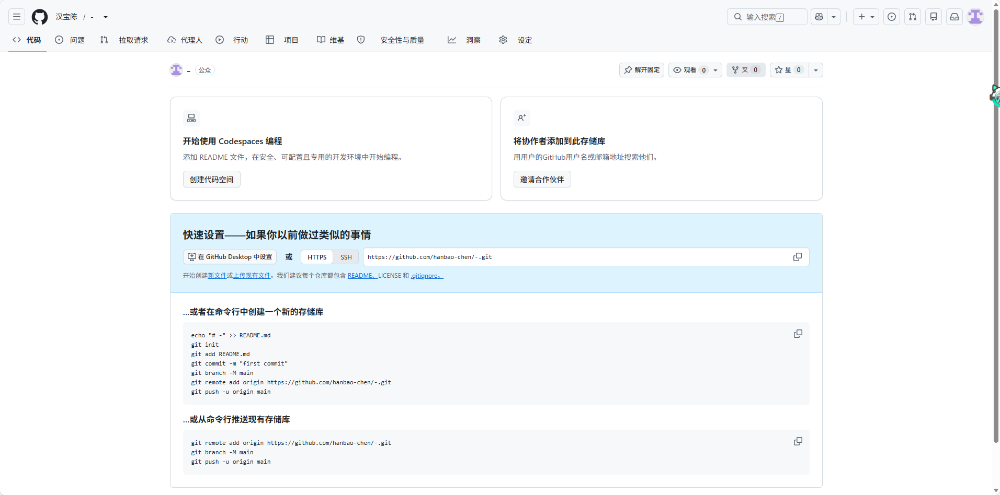

# 海洋数据挖掘技术课程作业完整研究对话

作者：朱宸浩　学号：22634107

本文件直接转换本作业会话的实际持久化记录。用户原文、AI对外文字和结构化问题均保留；没有将摘要扩写为虚构对话。
应用自动注入的环境配置、系统与开发者指令、模型内部推理不属于人机研究对话，不导出。代码、实验原始计数与工程核查见仓库experiments目录。
导出时仍在准备和发布交付物；截止时间之后的上传完成通知不在本次快照中。导出时间、记录条数和源记录指纹见export_metadata.json。

## 用户 · 2026-11-19T20:35:35.307000+08:00

这次我《海洋数据挖掘技术》课程大作业的具体要求：

（1）选定具体切入点：从我讲过的这七次课里，任选一个非常具体的知识点作为你的课题（比如 H3 空间编码，或者探讨 Workflow 工作流与 Agent 智能体的真实界限等）。切记不要选太宽泛的大题目，切入点越小、越具体越好。

（2）做出原创性探索：基于你选定的这个知识点，去做一些有原创性的延伸和创新。你可以去挖一下这个细分方向目前最前沿的技术演进和行业争议，更重要的是提出你自己的改进思路、新玩法或实验验证，最终形成一份完整的实验报告。

（3）全流程记录 AI 协作：这次作业非常鼓励大家深度使用 AI，但有一个硬性要求——你需要把你和 AI 讨论、推导、完成这份报告的全部完整聊天记录，导出保存为 Markdown（.md）格式的文件，并上传到你自己的 GitHub 仓库里。

（4）报告提交与核查：你的实验报告里需要对你提出的“原创创新点”进行非常详尽、清晰的拆解和描述；同时，务必把第（3）步里的 GitHub 仓库链接直接贴在报告显著位置（注意把仓库设为 Public 公开，确保我能直接点开）。我会逐个点进去看你们的对话过程和报告并给出评分。

特别提醒：千万不要直接丢一句话让 AI 帮你一键生成整篇报告。我想在报告和聊天记录里看到的，是你怎么一步步追问 AI、怎么反驳它、怎么把你自己的原创思想融合进去的。要有你自己的思考，这才是这次大作业的核心。

基于上述要求，我需要你告诉我完成这个作业的流程、我需要分步问你的问题、我是否需要另起对话，主要的要求在于我与你的对话上所生成出来的课题，最后的课题需要你去做一定的实验，具体做什么实验根据你一会的选题而定，我电脑有的软件有matlab，python，ansys，sw，AD，keil等等

## AI · 2026-11-19T20:37:15.910000+08:00

我先把作业拆成选题、追问、实验和留痕几个阶段，并核实聊天记录的保存方式。课题会尽量收窄到能用 Python 或 MATLAB 做出对照实验的尺度，再根据你们七次课的内容确定。

## AI · 2026-11-19T20:37:44.792000+08:00

我会用 `openai-docs` 技能核实当前应用的记录方式。选题上先把 H3 作为候选，但还需要确认七次课的实际内容，才能保证课题符合老师的范围要求。

## AI结构化提问 · 2026-11-19T12:37:46.882Z

请列出七次课的标题或主要知识点；如果方便，也请一起说明截止日期，以及你更熟悉 Python 还是 MATLAB。还没整理好时，我会先按“学过 H3、普通个人电脑、优先 Python”的假设给你一套候选方案。

## AI · 2026-11-19T20:38:56.604000+08:00

H3 里有一个值得追问的小问题：近岸网格包含陆地时，按整格面积算密度与按实际海域面积算密度，结果会怎样变化？校正后，海域面积很小的格子又可能因少数观测点而出现极高密度。这适合做成“发现问题—提出修正—检验修正副作用”的实验；目前还只是候选思路，不能先宣称它是全新方法。

## AI · 2026-11-19T20:40:07.324000+08:00

**不必另开对话，可以从这条对话继续。建议把作业做成一项“小型、可复现的研究”：由你逐步作出判断，我负责辅助查证、推导和实现实验，最后依据真实结果写报告。**

老师特别强调的是你的思考过程。因此，提问的重点应放在“为什么这样选、这个解释有没有漏洞、如何验证”，而不是累积聊天轮数。

下面给你一套可以实际执行的流程。

**1．先确认课程范围，再定题**

首先需要你提供七次课的标题或主要知识点，最好同时给出截止日期，以及你对 Python、MATLAB 的熟悉程度。讲义目录或你整理的课堂笔记也可以。

你下一轮可以这样问：

> 七次课分别讲了……。我比较熟悉……，截止日期是……。请从课堂知识里提出三个非常具体、能在我电脑上完成实验的课题，比较研究问题、数据来源、实验难度和可能的创新空间，先不要写报告。

这一轮结束时，我们应得到：**三个候选题，以及选择其中一个的明确理由。**

你需要加入自己的偏好，例如对船舶轨迹、海洋观测、空间编码或智能体更感兴趣，以及是否愿意学习新工具。

**2．我目前优先建议的候选题**

在尚未看到课程内容的情况下，假如课堂确实讲过 H3，我建议优先考虑：

> **《近岸 H3 网格的海域面积校正会不会制造虚假热点？——小海域网格的密度估计与稳定化实验》**

它只研究一个很具体的问题：**近岸格子里有陆地，计算海上观测点密度时，分母应该怎么取？**

用一个假设例子说明：

- 某格总面积为 1 平方千米，其中只有 0.1 平方千米是海域。
- 格子里有 10 个海上观测点。
- 按总面积计算，密度为 10 点/平方千米。
- 按海域面积计算，密度为 100 点/平方千米。

这里首先需要你作出判断：我们想描述的是每格观测总量，还是每平方千米海域的观测强度？两者回答的问题不同。

接着可以追问：如果海域只剩很小一角，偶然出现一个点，按海域面积相除是否会产生一个极高的“热点”？

另外，H3 同一分辨率的格子面积也存在差异，不能直接把所有格子当作等面积。官方文档明确说明了这一点，并提供单个格子的面积计算接口。[H3 面积说明](https://h3geo.org/docs/core-library/restable/)、[面积计算接口](https://h3geo.org/docs/api/misc/)

这个题目的优点是：**切入点小、海洋背景明确、能做定量对照，而且容易产生值得讨论的失败案例。**

目前的改进候选是：对海域面积很小、证据不足的格子，将密度估计适度向区域平均水平收缩，检验它是否能减少虚假热点，以及是否会抹掉真实的小范围热点。

**面积校正和统计收缩都有既有研究基础。**我们需要先查文献，再准确界定自己的贡献；可以是具体改进、适用条件或新的实验发现，不能提前声称“首次提出”。

**3．围绕选题，按下面顺序与我讨论**

以下是提问框架。你可以参考，但其中的观点和质疑应该来自你真实的理解。

| 阶段 | 你可以问我的问题 | 这一轮应形成的成果 |
|---|---|---|
| 理解问题 | “请用具体例子解释这个问题。它在什么条件下才存在？我需要掌握哪些概念？” | 研究问题、关键概念和适用范围 |
| 查证已有工作 | “请检索相关论文和官方资料，区分成熟做法、已有改进和仍值得研究的问题，给出可核查来源。” | 文献笔记、现有方法比较 |
| 提出自己的判断 | “我的理解是……，但我不认同你刚才的……，因为……。请检查我的推理。” | 你的观点，以及修正过程 |
| 形成研究假设 | “根据刚才讨论，把我们的想法改成一个可能被实验推翻的假设，并说明什么结果意味着失败。” | 可检验的假设 |
| 设计实验 | “先设计对照组、变量、指标和参数选择规则，指出哪些设置可能让结果偏向我们的方法。” | 实验方案 |
| 实现和运行 | “先实现最小实验并实际运行，解释每张图和每项输出。我确认理解后再扩大实验。” | 代码、原始数据、运行记录 |
| 分析与反驳 | “结果真的支持我们的假设吗？有没有其他解释？请找出方法失效的场景，并设计补充实验。” | 结果解释、失败案例和必要的补充实验 |
| 整理报告 | “根据已经完成的讨论和实验，先列报告提纲，并标出每项结论的证据。我确认后再分节写作。” | 有证据支撑的报告 |

**不需要刻意反驳我，也不需要每轮都提出新点子。**看不懂时要求解释、发现实验不公平时要求重做、认为结果不足时拒绝下结论，都是有价值的研究过程。

**4．如果采用上述 H3 课题，具体做什么实验**

可以分为两层，先完成能严格验证的部分，再考虑真实场景。

第一层是**已知真值的模拟实验**。设置简化岸线，在海域内生成已知强度的随机观测点，包括均匀分布和局部真实热点。这里明确使用模拟数据，不将它包装成真实船舶数据。

比较的方法可以包括：

| 方法 | 作用 |
|---|---|
| 点数 ÷ 完整格子面积 | 检查使用完整面积的影响 |
| 点数 ÷ 实际海域面积 | 检查海域面积校正的效果和副作用 |
| 排除海域占比过小的格子 | 一个简单、容易解释的对照方案 |
| 海域面积校正＋统计收缩 | 待检验的改进候选 |

我们逐步改变观测点稀疏程度、H3 分辨率和岸线形状，观察：

- 密度估计与真值的误差；
- 真实热点识别情况和虚假热点数量；
- 不同随机重复下结果是否稳定；
- 改进是否牺牲了对小范围真实热点的识别能力。

参数应在调参数据上确定，再到独立数据上评价；各方法使用相同场景。**如果结果显示改进只在某些条件下有效，或者整体没有优势，也应如实保留。**

第二层是**真实海岸线的案例验证**。数据条件允许时，再引入公开海岸线和合适的公开观测数据。真实数据通常没有已知真值，可以检查结果稳定性和空间分布是否合理，但不能据此直接宣布准确率提高。

这两层可以形成清楚的证据链：模拟实验解释机制，真实案例检查实际适用性。

**5．你的软件如何安排**

这个候选题建议以 **Python 为主**，完成空间处理、实验、统计和绘图；MATLAB 可以用于你更熟悉的分析或复核。

ANSYS、SolidWorks、AD、Keil 暂时没有必要加入这个课题。软件的选择由研究问题决定，重点是实验设计和结果解释。

选题确定后，我可以协助编写并实际运行实验，保留代码、参数、随机种子、原始结果和图表。具体运行环境届时检查。**目前尚未运行任何实验，上述只是候选方案。**

**6．聊天记录从现在开始保存**

这条对话已经包含选题规划，建议纳入最终记录。先做一次小规模导出核对，确认能够保存双方消息和代码块，再进入长时间实验。

保存时应做到：

- 保留完整的用户提问、AI 回答、纠错和失败讨论；
- 阶段总结单独保存，不能替代完整聊天记录；
- 如果后续拆成多个对话，每个对话分别完整导出，并写清先后关系；
- 附件、代码和实验输出另存，聊天记录中保留对应说明。

我后续整理的“讨论总结”只能算辅助材料，**完整记录应来自实际聊天历史的导出或逐轮原样保存，不能靠事后回忆重写。**

官方文档已确认 Codex 终端版支持用 `/export session.md` 导出完整 Markdown 对话；你当前桌面版的具体入口需要按实际版本核对。[官方导出说明](https://learn.chatgpt.com/docs/developer-commands?surface=cli)

**不建议现在另开对话。**如果以后为实验调试单独开一个对话，也要把它纳入完整记录，并在新对话中说明与主对话的关系。

**7．最后按“报告＋过程证据＋复现材料”提交**

建议 GitHub 仓库包含：

```text
README.md          课题介绍、目录和复现方法
report/            最终实验报告
conversations/     完整 Markdown 聊天记录
src/               实验代码
data/              可公开数据或下载说明、模拟数据生成代码
results/           原始结果和图表
requirements.txt   Python 依赖
```

报告首页显著位置直接放 **Public 仓库链接**。提交前用未登录 GitHub 的浏览器检查，确认老师能打开报告、聊天记录和代码。

报告中的创新点应逐项说明：**已有方法是什么、你发现了什么问题、你的判断如何形成、具体改了什么、实验支持到什么程度、还有哪些失败条件。**这些内容都应能对应到真实对话和实验文件。

下一步先提供七次课的内容、截止日期和你的编程基础，我们就从候选题比较开始，逐轮推进。

## 用户 · 2026-11-19T20:47:52.546000+08:00

应用传入的结构化答复原文：

```xml
<send_user_message_question_reply>
[{"questionItemId":"[\"request_user_input_async\",\"call_fcdc793dbfdf4c22bb386d113c850fd0\",0]","question":"请列出七次课的标题或主要知识点；如果方便，也请一起说明截止日期，以及你更熟悉 Python 还是 MATLAB。还没整理好时，我会先按“学过 H3、普通个人电脑、优先 Python”的假设给你一套候选方案。","answer":"今天就需要生成出来，软件任选即可。C:\\Users\\98198\\Desktop\\海洋数据挖掘技术可以访问这个文件夹中的ppt文件，里面是讲课的课件，还有一份pdf文件是同学所做过的课程作业可以作为参考"}]
</send_user_message_question_reply>
```

## AI · 2026-11-19T20:47:59.590000+08:00

我先查看这个文件夹里的课件和参考作业，确认课程范围，再选一个今天能完成实际实验的具体问题。我会用演示文稿和 PDF 技能读取材料；参考作业主要用来了解结构和深度。

## AI · 2026-11-19T20:49:36.666000+08:00

课件里确实讲了 H3，而且已经明确要求“除以有效海域面积”，所以面积校正本身不能作为创新点。可以继续追问：海域只剩一小角的格子，出现一两艘船后算出的高密度，应该直接当作热点，还是需要更多证据？

参考作业研究的是重试抖动。我们可以借鉴它记录对照实验的方式，采用不同的课题。

## AI结构化提问 · 2026-11-19T12:49:40.240Z

对于“海域很小、仅出现1～2艘船，却算出极高密度”的格子，你的初步判断是什么？这会决定实验优先评价什么；请按真实想法选择，也可以直接说哪里没理解。
- 我更担心把偶然出现的船误报成热点，想先减少虚假热点
- 我更担心漏掉真实的小范围热点，希望保留灵敏度
- 我认为两者都要比较，先看实验能否找到适用边界

## 用户 · 2026-11-19T20:50:33.297000+08:00

应用传入的结构化答复原文：

```xml
<send_user_message_question_reply>
[{"questionItemId":"[\"request_user_input_async\",\"call_037df519828d441f86f660ff05cf8acc\",0]","question":"对于“海域很小、仅出现1～2艘船，却算出极高密度”的格子，你的初步判断是什么？这会决定实验优先评价什么；请按真实想法选择，也可以直接说哪里没理解。","answer":"我认为两者都要比较，先看实验能否找到适用边界"}]
</send_user_message_question_reply>
```

## AI · 2026-11-19T20:50:54.706000+08:00

按你的判断，实验会同时评价误报和漏报，寻找适用边界。查到的资料也提醒：统计收缩虽然能减少小样本产生的极端值，却可能压低真实的小热点。

我会先把场景和评价规则写下来，再运行实验。这里用模拟船位快照建立已知真值；结果的结论会限定在这个模型内。[相关研究](https://sites.stat.columbia.edu/gelman/research/published/allmaps.pdf)

## 用户 · 2026-11-19T20:50:59.782000+08:00

其实没有理解，讲一下你的判断吧

## AI · 2026-11-19T20:51:42.902000+08:00

刚才我讲得太技术化了。**我的判断是：海域面积校正必须做，但校正后的高密度，还需要判断证据够不够。**

举个例子，假设我们只看某一时刻的船位：

| 格子 | 格子内实际海域面积 | 看到的船 | 算出的密度 |
|---|---:|---:|---:|
| A | 1 平方千米 | 10 艘 | 10 艘/平方千米 |
| B | 0.01 平方千米 | 1 艘 | 100 艘/平方千米 |

B 的密度确实是 A 的十倍，**算术没有错**。但凭这一次观察，我们还不能确定 B 平时就更繁忙。

B 可能有两种情况：

- **偶然路过：**平时没船，拍快照时恰好有一艘。它看起来特别“热”，主要因为海域面积太小。
- **真实热点：**那里是一个小港口入口，经常有船经过。面积虽小，高密度却有实际意义。

这就出现了值得研究的问题：**怎样减少第一种情况造成的误判，同时尽量保住第二种真实热点？**

我提出的“收缩”，可以理解为：**对证据少的格子，暂时把估计放得保守一些。**例如，看到 B 的一次极高密度时，结合周边或区域的常见水平作估计。观测证据越充分，就越相信格子自己的数据。

但这个办法也有代价：如果 B 真是一个很小的繁忙港口，把它压低就会漏掉真实热点。因此，我不会预先认定这个改进更好。

**我建议做的实验，就是故意安排上述两种情况来考它：**

1. 生成一个各处真实密度相同的模拟海域，检查哪些方法会把小格子误报成热点。
2. 再放入一个真实的小范围热点，检查这些方法会不会把它压没。
3. 改变观测多少、格子大小和校正强度，找出什么时候值得保守、什么时候保守会误事。

用模拟数据，是因为我们能够事先知道哪里真的繁忙，才能核对判断是否正确。最后再根据条件考虑真实数据案例。

所以，我更建议把题目暂定为：

> **《近岸 H3 小海域网格的高密度可信吗？——虚假热点与真实热点的对照实验》**

这里的探索价值是：在老师已经讲过的“按有效海域面积计算密度”之后，继续检验它在稀疏数据下的可靠性，以及修正方法的代价。**统计收缩是已有方法，我们的贡献需要通过具体实验和适用边界来体现。**

你刚才选了“两者都比较”，现在又说明其实没理解，完全可以保留这个真实过程。报告里会准确写成“AI 提出候选思路，学生要求进一步解释”，不会把那个选择写成你已经提出了研究结论。

## 用户 · 2026-11-19T20:52:33.836000+08:00

这样我理解了，就选这个题目吧。先做你说的两种情况的对照实验，看看会不会误报或漏掉真实热点，再把结果解释给我听。

## AI · 2026-11-19T20:52:40.206000+08:00

我会先固定两种场景：一处真实密度处处相同，另一处含有一个真实的小范围热点。两种场景都比较直接按海域面积计算密度和保守修正后的结果，并同时记录误报、漏报。

## AI · 2026-11-19T20:56:16.298000+08:00

实验已运行：每种场景重复了 2,000 次。结果显示出明显的代价：保守修正减少了误报，但小范围真实热点的检出率也从 67.5% 降到了 8.7%。

我正在用泊松模型的理论概率复核这个下降，并整理图表。复核能帮助区分：这是修正规则本身造成的漏报，还是实现出了问题。

## AI · 2026-11-19T21:00:40.205000+08:00

复核通过了。小热点的海域面积只有约 0.275 平方千米，即使真实密度较高，每张快照平均也只看到约 1.1 艘船。

直接面积法看到至少 1 艘就会判为热点；本次保守修正需要至少 3 艘。因此，很多看到 1～2 艘船的真实热点被压掉了。预设的较轻修正在本轮保住了检出率，但还需要新场景验证，才能判断它是否可靠。

## AI · 2026-11-19T21:02:01.114000+08:00

**实验已经实际跑完。结果是：本次保守修正减少了误报，但也漏掉了大量真实的小热点，不能直接当作更好的方案。**

我使用真实 H3 网格、人工岸线和模拟船位，每种场景重复 **2,000 次**。模拟数据能让我们事先知道哪里真的繁忙，方便核对判断。

第一种场景各处真实密度相同，没有热点；第二种场景放入两个真实密度相同的热点，一个海域面积很小，另一个整格都是海域。

| 检查内容 | 直接按海域面积计算 | 本次保守修正 |
|---|---:|---:|
| 没有真实热点：每张图平均误报格数，越少越好 | 0.933 | **0.039** |
| 真实小海域热点：检出率，越高越好 | **67.5%** | 8.7% |
| 真实完整海域热点：检出率，越高越好 | **98.1%** | 95.85% |

这意味着：**修正后，虚假热点确实少了，但真实小热点的漏报率也从32.5%升到了91.3%。**

为什么会这样？关键在于这个小热点的实际海域只有约 **0.275平方千米**。

虽然它的真实密度被设为每平方千米4艘，但面积小，每张快照平均也只有：

**4 × 0.275 ≈ 1.1艘船。**

因此，真实热点也经常只看到零艘、一艘或两艘。

- **直接面积法：**看到一艘，密度约为3.63艘/平方千米，超过本实验设定的热点门槛2，就判为热点。
- **本次保守修正：**看到一艘或两艘都会被压低，需要至少三艘才判为热点。

在2,000次模拟中，有1,176次恰好看到一艘或两艘。这些真实热点原本能被检出，修正后却被漏掉了。保存的计数和理论概率都支持这个解释。


**所以，我现在的判断是：面积归一仍然需要做，但“高密度”和“证据充分”应该分别判断。**直接把证据少的高密度压低，可能把值得关注的小热点一起消掉。

实验也出现了一个值得继续检查的线索：采用**更轻的修正**时，平均误报格数从0.933降到0.493，小热点检出率仍为67.5%。不过，这只是当前面积和阈值下的表现，还不能说找到了最佳参数。

下一步值得追问的是：**能否保留这些高密度区域作为候选，同时标注“证据不足、需要继续观察”，而不是直接把它们判成不热？**

本轮结果仅适用于这组模拟条件，尚未验证真实港口。代码、原始计数、图表和阶段性聊天记录均已保存：

[阅读完整实验说明](C:/Users/98198/Documents/Codex/2026-11-19/d/outputs/h3_coastal_experiment/STAGE1_RESULTS.md) · [下载实验材料包](C:/Users/98198/Documents/Codex/2026-11-19/d/outputs/H3_stage1_experiment.zip)

## 用户 · 2026-11-19T21:11:02.569000+08:00

你别这么快生成，我现在需要跟你确认几个问题

1. 弄清这次修正为什么失效。
2. 检查提高判定门槛能否达到类似效果。

## AI · 2026-11-19T21:11:14.941000+08:00

我先停下报告整理，集中核查这两个问题。我会先推导修正公式如何改变热点判定，再用已保存的数据比较：直接提高门槛，能否得到相近的误报和检出结果。

## AI · 2026-11-19T21:14:25.591000+08:00

先停在这两个问题上。**核查后的关键发现是：这次修正用于“判定热点”时，数学上等价于提高门槛，只不过每个格子提高的幅度不同。**上一轮缺少这个直接对照，不能仅凭误报减少就认定修正更好。

我复用了保存的数据追加判定对照，没有改变原场景和原始结果。

**1．为什么这次修正漏掉了小热点？**

原修正的意思是：把本格密度与区域平均密度加权平均。对于那个小海域格，实际权重是：

> 修正结果 ≈ **21.6% × 本格密度 ＋ 78.4% × 区域平均密度**

区域平均密度约为 **0.523艘/平方千米**。也就是说，我们给了“全区域通常不繁忙”很大权重，却给这个小格自己的观测较小权重。

这在小格确实不繁忙时能抑制误报；但它真的繁忙时，也会被强行拉低。

| 小格看到的船数 | 直接计算的密度 | 修正后密度 | 是否超过门槛2 |
|---|---:|---:|---|
| 1艘 | 3.63 | 1.19 | 修正后未检出 |
| 2艘 | 7.26 | 1.98 | 修正后未检出 |
| 3艘 | 10.89 | 2.76 | 两种方法均检出 |

更能说明问题的是：它的**真实密度为4**，但修正后的长期平均估计只有约 **1.27**，已经低于热点门槛2。

因此，根源有两点：

- **修正力度过大：**相对于0.275平方千米的小海域，设定的修正强度太重。
- **区域平均不能代表真实小热点：**面积小只意味着观测容易波动，并不意味着它的真实密度应该接近全区域平均。

所以，这个方法在减少波动方面有效，却没有实现我们希望的“减少误报，同时保住真实小热点”。

**2．直接提高判定门槛，能否达到类似效果？**

能。我补算了下面的结果：

| 判定方法 | 均匀场景：每图平均误报格数↓ | 小海域热点检出率↑ | 完整海域热点检出率↑ |
|---|---:|---:|---:|
| 直接密度，门槛2 | 0.933 | 67.50% | 98.10% |
| 直接密度，门槛4 | 0.236 | 30.15% | 44.90% |
| 直接密度，门槛8 | 0.092 | 8.70% | 0% |
| 原来的保守修正，门槛2 | 0.039 | 8.70% | 95.85% |

**单纯提高门槛，同样能减少误报，也会增加漏报。**这说明“误报变少”本身不足以证明修正具有额外价值。

但修正与统一提高门槛有一个区别：**它对小格更严，对大格较宽松。**

把公式展开就能看出来。设直接密度为 \(D\)，海域面积为 \(A\)，区域平均为 \(m\)，修正强度为 \(\tau\)，则：

\[
\text{修正后密度}>2
\quad\Longleftrightarrow\quad
D>2+\frac{\tau(2-m)}{A}
\]

代入本轮参数，约相当于：

- 小海域格：直接密度门槛从 **2提高到7.36**。
- 完整海域格：直接密度门槛从 **2提高到2.37**。

我按每次实际历史均值计算这个等价门槛，核对了两种场景合计 **70.4万次格子判定，结果完全一致**。

这也解释了表中的现象：统一门槛8虽然能得到相同的小热点检出率，却把完整海域热点也几乎全部挡掉；原修正对完整格没有那么严。

我还按模拟背景的理论概率，把统一门槛校准到相近误报水平，得到约17.59。此时每图误报为0.0315，但小热点检出率只剩1.1%，完整格热点为0%。这是诊断用的对照，不能作为实际业务推荐门槛。

**目前应把方法准确理解为“根据面积和历史均值提高判定门槛”。真正需要继续研究的，是这个门槛提高得是否合理，而不是只看修正后的地图是否更干净。**

## 用户 · 2026-11-19T21:16:28.162000+08:00

现在我理解了，这次修正相当于对小海域提高热点门槛。但如果只看某一时刻的一两艘船，我们是不是本来就很难区分“偶然路过”和“长期真实热点”？请结合当前的小格子解释，哪些情况能判断，哪些情况证据不足。

你之前提到把“密度高”和“证据充分”分开。能不能保留原始密度，把证据不足的高密度格子标成“待观察”，再通过后续观测判断？这样是否真正改善了判断，还是只是把漏报换了一个名字？请先解释思路和可能失败的情况，暂时不要直接生成报告。

## AI · 2026-11-19T21:16:34.378000+08:00

我会用当前小格子的参数，比较同样看到0、1、2艘船在普通海域和真实热点里分别有多常见。再说明“待观察”需要怎样接收后续证据，以及怎样评价它，才不会把漏报藏起来。

## AI · 2026-11-19T21:19:54.157000+08:00

**是的。单次看到一两艘船，通常只能提供强弱不同的线索，很难直接区分“偶然出现”和“长期真实热点”。保留原始密度、允许暂不下结论是合理的，但只有后续证据和评价规则都落实，才可能改善判断。**

先用当前小格子说明。下面是根据现有模型计算的概率，没有开展新的时序实验。

**1．当前小格子能告诉我们什么？**

它的海域面积约为 **0.275平方千米**。比较两种假设：

- 普通海域：真实密度为0.5艘/平方千米。
- 真实热点：真实密度为4艘/平方千米。

| 单次观测 | 普通海域中出现的概率 | 真实热点中出现的概率 | 可以怎样理解 |
|---|---:|---:|---|
| 0艘 | 87.13% | 33.23% | 更符合普通海域，但不能排除热点 |
| 恰好1艘 | 12.00% | 36.61% | 值得关注，但普通海域也不罕见 |
| 恰好2艘 | 0.83% | 20.17% | 明显更支持高密度，需要继续核实 |
| 至少3艘 | 0.039% | 10.00% | 对“密度只有0.5”的假设构成较强反证 |

这里有两个边界。

**第一，能确定“这次看到多少”，不能直接确定“长期通常有多少”。**看到一艘时，当前观测密度确实是3.63；但这个数不能独自证明长期平均也这么高。

**第二，“不像密度0.5”，还不等于“已经充分证明密度超过2”。**例如，真实密度恰好为2时，这个小格单次出现至少两艘的概率仍约为 **10.6%**。所以，两艘是有价值的线索，却不足以机械地认定长期热点。

同样，表里的0.83%是“普通海域出现这种观测的概率”，不是“这里不是热点的概率”。这种条件不能倒过来读。[美国统计学会的解释](https://www.amstat.org/asa/files/pdfs/P-ValueStatement.pdf)

而且，原实验假设密度保持不变。现实中“一次船队经过”和“长期繁忙港口”都可能产生同样的一张快照，**单张图本身没有记录持续时间的信息。**

**2．怎样把“密度高”和“证据充分”分开？**

可以保留两个独立输出：

| 输出 | 回答的问题 |
|---|---|
| 当前观测密度：船数÷海域面积 | 这一刻看起来多密？ |
| 对持续热点的证据状态 | 已有观测是否足以支持持续高密度？ |

例如，看到一艘时可以显示：

> 当前观测：1艘；海域面积：0.275平方千米；观测密度：3.63艘/平方千米。  
> 持续热点判断：待观察，当前样本不足。

这样既保留高值，也没有把它提前宣布为长期热点。

但**“待观察”必须对应后续更新规则**。假设预先约定再观察，累计得到10次可比较的快照：

- **总共只出现1船次：**平均观测密度约0.36，最初的高值没有持续。
- **总共出现6船次：**平均密度约2.18，虽然略高于门槛2，仍可能只是波动，证据未必充分。
- **总共出现11船次：**平均密度约3.99，对持续高密度的支持更强。

累计平均密度的分母是 **10×海域面积**，不能把十次船数相加后仍只除一次面积。

这些例子依赖观测可比、模型合适等条件；它们说明新证据怎样改变判断，不是已经验证的最终规则。

另外，**上一轮实验其实保存了各格20次历史快照的合并计数，但修正算法只使用全区域平均值。**对于“长期热点”这个目标，这样没有充分利用本格历史。后面若研究持续性，应该把这些局部历史纳入，并让简单对照方法获得同样的数据。

**3．这是真改善，还是把漏报改叫“待观察”？**

需要分开评价。

**只增加标签时，信息表达可以更诚实，但识别能力没有自动增强。**同样的数据没有凭空增加信息。允许暂不判定的思想已有研究基础，其评价需要同时考虑错误率和作出判断的覆盖率。[选择性分类研究](https://jmlr.org/papers/v11/el-yaniv10a.html)

**得到后续有效观测后，才有机会真正提高识别能力。**但必须在相同观测次数、相同截止时间下比较，不能让新方法观察十次，却让基线只观察一次。

评价时尤其不能把“待观察”从统计中删掉。例如：

> 100个真实热点，到截止时间确认了10个，80个仍待观察，10个判为非热点。  
> 按时确认率仍然是10%，不能因为保留了候选，就声称找到了90%。

我们需要分别记录：

- 截止前确认了多少真实热点、误确认了多少普通区域；
- 多少真实热点仍待观察，多少被判为非热点；
- 确认需要多久，以及产生多少待观察任务和观测成本。

**到期仍待观察的真实热点，仍然是“尚未检出”，不能算成功。**只是它与“已经被错误排除”具有不同的后续处理价值。

**4．这个思路可能怎样失败？**

- **只观察最初的高密度格子。**当前真实小热点有约三分之一的快照看不到船；如果零艘就退出观察，这批热点仍会漏掉。
- **把相关记录当成独立新证据。**同一艘船停留期间连续发报，不能等同于很多次独立观察。计算平均在场密度时可以记录其持续占用，但不能说来了很多艘不同的船。
- **只在高峰时观察。**例如只观察涨潮出港时段，结果不能代表全天；接收设备掉线也不能直接记为零艘。
- **热点本身变化。**长期平均会掩盖短时热点。因此必须先约定，我们要识别的是“未来一小时的拥挤”还是“过去一周的持续繁忙”。
- **一直检查，碰到一次满足条件就确认。**反复检查需要专门的统计规则；简单套用一次性判据可能累积误报。也可以先采用固定观测窗口，降低这个问题的复杂度。[持续检查的统计方法](https://arxiv.org/abs/1810.08240)

我的建议是，暂时保留你的这个方向：**原始密度照常展示，长期判断允许待定；设定明确的观察窗口和截止时间，用新增证据更新状态。**下一步是否成立，应与“使用同样历史和后续数据的简单累计判断”比较，检查它能否在控制误报的同时，更及时地确认真实热点。

## 用户 · 2026-11-19T21:20:34.715000+08:00

1. **补充公平对照**
   > 你目前比较了统一门槛和面积相关门槛。是否还有成熟的、根据面积和背景密度判断热点证据的方法？请查证后选一个合理基线，说明我们的方案还剩下什么值得探索。
2. **设计连续观测实验**
   > 如果增加观测次数，误报和漏报会怎样变化？请让所有方法使用相同的观测数据，并同时评价判断准确性和等待时间。另外，同一艘船连续出现，能不能算多份独立证据？
3. **检查“待观察”的代价**
   > 如果增加“待观察”类别，请分别统计确认热点、待观察和未检出的结果。待观察区域太多，会不会增加核查负担？怎样证明这套方案带来了实际收益？做一下以上的判断

## AI · 2026-11-19T21:20:42.269000+08:00

我先查证一个成熟的热点证据判定方法，再让所有方法使用同一批连续观测，比较误报、漏报、等待时间和“待观察”的负担。实验会分别模拟独立快照和船舶持续停留，检查把相关观测当成独立证据会带来什么问题。

## AI · 2026-11-19T21:25:51.988000+08:00

查到一个合适的基线：**带观测暴露量的单侧精确泊松检验**。它直接判断累计船数是否高于给定面积、观测次数和背景水平所能解释的范围，不需要先压低密度。[R 官方方法说明](https://stat.ethz.ch/R-manual/R-devel/library/stats/html/poisson.test.html)

本轮仍把“真实密度超过2”作为热点目标；只检验“是否高于背景0.5”会更容易通过，但回答的是另一个问题。连续检查时，我也会校正多次查看带来的误报风险。

## AI · 2026-11-19T21:29:52.477000+08:00

连续观测实验已完成。独立快照下，逐步检验能较早确认热点；但把同一组船的5张重复快照当成5份独立证据，会产生过度确信。正确按独立船组计数后，小热点的确认率低得多。

“待观察”本身也没有增加信息：使用同一套证据时，二分类和三分类确认的热点完全相同。接下来我会核对未决比例和等待时间，把这些代价一起算进去。

## 用户 · 2026-11-19T21:32:14.254000+08:00

你生成快一点就行，速度优先

## AI · 2026-11-19T21:33:29.961000+08:00

已完成查证和补充实验。**成熟方法能直接判断热点证据；我们的探索重点应转向：需要多少有效观测、要等多久，以及“待观察”会积压多少任务。**

**1．公平基线：选精确泊松检验**

这是成熟方法，R 官方已有实现，能结合计数和观测暴露量检验密度。[官方说明](https://stat.ethz.ch/R-manual/R-devel/library/stats/html/poisson.test.html)

放到当前问题中：

- 累计船数为 \(K\)，有效独立观测次数为 \(n\)，海域面积为 \(A\)。
- 如果真实密度为门槛2，预期累计船数就是 \(2An\)。
- 检查实际船数是否显著高于这个水平，决定是否有证据支持热点。
- 证据支持低于2时判为非热点，两边都证据不足时保持待观察。

本轮还对**176个格子、7次检查和两个判断方向**做了多重检验校正，在模型成立时，把全图出现错误证据的概率上界控制在5%。[校正方法说明](https://stat.ethz.ch/R-manual/R-devel/library/stats/html/p.adjust.html)

因此，**“按面积判断证据”和“允许待观察”都有成熟基础，不能算我们发明的新算法。**值得探索的是它们在近岸小格、重复船位和有限等待时间下的具体效果。

**2．连续观测：有效信息增加有用，重复照片不等于新证据**

每个场景运行2,000条模拟序列，每条120轮。同一场景内，所有方法共享相同观测数据。

先看独立快照下，逐步泊松检验对当前小热点的结果：

| 已观察轮数 | 确认热点 | 待观察 | 判为非热点 |
|---|---:|---:|---:|
| 10轮 | 3.20% | 96.80% | 0% |
| 40轮 | 47.90% | 52.10% | 0% |
| 80轮 | 93.90% | 6.10% | 0% |
| 120轮 | 99.85% | 0.15% | 0% |

**更多独立观测确实帮助我们确认小热点。**但严格控制全图误报后，确认需要等待。

与“等到120轮才检验”比较：

- 固定窗口：120轮才发布，小热点检出率100%。
- 逐步检验：包括未确认案例在内，截尾平均等待为60.14轮；截止检出率99.85%。未确认案例按120轮计入等待，没有只统计成功案例。

误报也要看完整过程。普通海域中，直接累计密度法到120轮平均仅误报0.002格，但**75.15%的序列在此前某次检查中曾报过热点**。最后一张图变正确，不能抹掉之前发出的错误警报。

接着模拟：**同一组船连续出现5轮，然后才换成另一组独立船位。**

120张照片实际上只有24组独立信息。小热点的最终结果为：

| 处理重复观测的方法 | 确认热点 | 待观察 | 判为非热点 |
|---|---:|---:|---:|
| 错误地把每张照片当成独立证据 | 91.05% | 7.75% | 1.20% |
| 正确按独立船组计算证据 | 15.95% | 84.05% | 0% |

第一行看起来确认得更多，但信心被夸大了。在“真实密度恰好为门槛2”的压力场景中：

- 错误计算独立性：**100%的模拟序列出现过至少一处错误热点确认**。
- 按独立船组校正：对应比例为 **1.55%**。

所以，同一艘船持续出现，可以计入**在场占用**，但不能自动贡献多份独立证据。真实数据中的相关性通常没有这种五轮分组那么整齐，需要另外估计。

**3．“待观察”有代价，不能把它算成成功**

上表正确校正后的84.05%，意味着：

> **到120轮仍有84.05%的真实小热点未被确认，截止未检出率就是84.05%，不能因为没有判错为非热点，就说没有漏报。**

核查负担也确实会积压：

- 普通背景加两个明显热点的独立观测场景：到120轮，平均约 **2.24/176格**仍待观察。
- 所有格子的真实密度都恰好等于门槛2的压力场景：平均约 **175.97/176格**仍待观察，其中约87.53格的观测密度高于2。

第二种是刻意设置的困难场景，但说明了一个实质问题：**大量区域接近门槛时，有限观测很难给出明确结论，待观察队列可能几乎装满。**

我还核对了一个关键点：**使用相同证据规则时，二分类和三分类确认的热点完全相同。**所以增加“待观察”标签，本身没有提高热点确认率。

要证明实际收益，应同时满足：

- 在相同数据、截止时间和误报约束下，更早或更多地确认真实热点；
- 截止未决案例仍计入未检出；
- 同时报告候选数量、等待时间和核查成本，不能只报已确认部分的准确率。

**本轮已经支持“独立证据积累能带来更可靠、较早的判断”，尚未证明三分类标签本身带来净收益。**尤其在重复观测和门槛附近，保留待观察只是诚实承认不确定性；它是否值得，需要结合最长等待时间和实际核查预算判断。

实验使用模拟数据、已知背景和已知重复分组，结果不能直接当成真实港口性能。代码、数据和核查结果已保存，未生成课程报告：[查看实验方案](C:/Users/98198/Documents/Codex/2026-11-19/d/outputs/h3_continuous_checks/PLAN.md)。

## 用户 · 2026-11-19T21:34:39.990000+08:00

我需要的是问答过程即可不用每次帮我生成新的方案，重要的是对话的过程，我需要知道你干什么，下面继续对话

## AI · 2026-11-19T21:35:04.803000+08:00

明白，后续就以问答推进，文档和报告等你明确要求时再整理。

我会讲清楚：**正在判断什么、依据是公式还是已有数据、是否运行了新实验，以及结果能说明到什么程度。**也会区分你的想法和我的建议，保留真实的讨论过程。

目前我们已经弄清修正的机制，并补上了成熟方法对照。**还没有证明“待观察＋后续观测”比使用同样数据的成熟方法更有实际收益。**这是当前尚未解决的核心问题。

你继续提问，我们围绕具体疑问往下讨论。

## 用户 · 2026-11-19T21:35:15.376000+08:00

1. **先理解独立观测**
   > 为什么120张照片可能只有24次有效观测？请用同一艘船连续停留的例子解释，“在场时间更长”和“独立证据更多”有什么区别？

## AI · 2026-11-19T21:36:15.538000+08:00

**120张照片只有24次有效观测，是上一轮实验的人为设定：每连续5张都是同一组船位，组与组之间才独立更新。**因此有 \(120÷5=24\) 组独立信息。真实数据不能一律这样折算。

用同一艘船连续停留的例子看：

第1张看到船A，第2～5张仍然看到船A，它一直停在那里。

这些照片确实告诉我们更多事情：**船A持续在场，停留时间较长。**但知道它已经停在那里后，下一张再次看到它并不意外。五次出现彼此有关，不能当作五次独立抽样。

两种信息回答的问题不同：

| 信息 | 能说明什么 |
|---|---|
| 同一艘船持续出现 | 它停留了多久、占用了这片海域多久 |
| 多次独立观测都出现较多船 | 换一个相对独立的观察机会，这片海域仍经常繁忙 |

例如，假设某次观察有10%的概率碰上一艘停留中的船，而且碰上后它必定连续出现在五张照片里，那么“五张都看到它”的概率仍是10%。如果误把五张当作独立事件，就会算成 \(10\%^5=0.001\%\)，于是把一件并不罕见的事误认为极强的热点证据。

**在当前小格子里，密度也不能重复累加。**

海域面积约0.275平方千米，连续五个等长观测时段都看到同一艘船：

- 每个时段在场船数都是1艘，观测密度都是约3.63艘/平方千米。
- 五次平均密度仍然是 \(5÷(5×0.275)≈3.63\)。
- 它提供了5个时段的在场记录，但没有变成5艘不同的船，也没有自动变成5份独立证据。

不过，**这些重复观测并非没有价值**。如果研究“停泊时间”或“持续占用”，它们很重要；如果研究“长期平均密度”，也应该保留，只是在计算不确定性时必须考虑时间相关性。

真实数据里，独立性还取决于船舶停留、船队同步进出、潮汐和接收条件等。换了船舶身份，也不必然独立。因此，后续要判断的是**相隔多久、在什么条件下，观测才提供足够不同的新信息**，不能只数照片张数。

## 用户 · 2026-11-19T21:36:27.128000+08:00

2. **理解看起来更好的错误结果**
   > 把重复照片当成独立证据后，检出率反而更高，为什么我们还认为这个结果不可靠？

## AI · 2026-11-19T21:37:15.947000+08:00

**因为它把“反复看到同一件事”误当成“多次独立验证”，产生了过度确信。检出率更高，不代表判断更可靠。**

在我们每5张完全重复的设定中，120张照片只有24组独立信息。错误方法却按120次独立观测计算，于是认为随机误差已经很小，更容易宣布“证据充分，确认热点”。

**同一批照片算出的平均密度没有改变，改变的是对这个密度有多确定。**在这个特定模型中，错误方法估算的标准误差只有实际值的约 \(1/\sqrt5\)，误差范围被明显压窄了。

这会同时产生两种效果：

- **这里确实是热点时：**更容易通过判定，因此检出率升高。
- **这里只是普通波动时：**也更容易把波动当成确定结论，造成误报。

我们此前看到的就是这种情况：

| 对重复观测的处理 | 真实小热点检出率 |
|---|---:|
| 错误地当作独立证据 | 91.05% |
| 按独立船组校正 | 15.95% |

91.05%这个数本身没有算错，也不能说这些检出全部是假的。**问题在于，这套方法无法保持它所承诺的误报控制。**

为检查这一点，我们另外设置了“真实密度恰好为2”的场景。热点定义是**严格高于2**，所以这些区域不应被确认成热点。结果：

- 错误处理独立性：2,000条模拟序列中，**每条都出现过至少一处错误热点确认**。
- 正确处理相关性：对应比例为 **1.55%**。

这里的100%指“整张图至少误确认过一处”，并非每个格子都误报。

因此，**检出率回答的是“真热点中找出了多少”，没有回答“普通区域会被误认多少”。**一个方法如果把所有区域都宣布为热点，检出率也能达到100%，但没有识别价值。

我们应比较的是：**在相同且有效的误报约束下，谁能检出更多真实热点、等待更短。**正确处理后的15.95%虽然不好看，却暴露了当前证据不足；它也不是最优结果，仍可以寻找更有效的方法，但不能靠重复计算证据来提高数字。

## 用户 · 2026-11-19T21:37:44.789000+08:00

3. **弄清统计数字的含义**
   > 你说“100%的模拟序列出现过至少一处错误热点确认”，这是否意味着每个格子都判断错了？请解释这个比例的统计对象。

## AI · 2026-11-19T21:38:15.936000+08:00

**不意味着每个格子都判断错了。这个100%的统计对象是“整条模拟序列”，而不是单个格子。**

本轮实验中：

- **一条序列：**对同一张包含176个海域格的地图，连续观察120轮，在7个预定时点检查。
- **一条序列算“出现过误报”：**只要任意一次检查中，任意一个非热点格被错误确认为热点，就记为1。
- 同一条序列错1格或错很多格，在这个指标中都只记一次。

计算方式是：

\[
\frac{\text{至少出现过一次错误热点确认的序列数}}
{\text{全部模拟序列数}}
\]

所以，**100%表示2,000条序列中，每条都曾出现至少一处误确认**，没有任何一条做到整个监测期间完全不误报。

例如，假设每条序列都只错1个格子，这个指标仍然是100%，但显然不是176个格子全错。

实际在刚才的边界压力场景中，错误处理独立性的逐步检验，到120轮平均每条序列误确认约 **19.6个格子，占176格约11.1%**。这与“至少出现一处误报的序列比例100%”是两个不同指标。

因此，后续我们应同时看：**每条序列误报多少格，以及多少条序列出现过误报**，不能只报其中一个。

## 用户 · 2026-11-19T21:38:25.334000+08:00

4. **讨论严格校正的代价**
   > 同时校正176个格子和多次检查，会不会让小热点很难被确认？这是实现问题，还是控制全图误报需要付出的代价？

## AI · 2026-11-19T21:39:25.595000+08:00

我只核对现有规则的判定门槛，区分两件事：控制全图误报本来就需要更强证据，以及当前校正方法是否又额外偏保守。

## AI · 2026-11-19T21:40:08.111000+08:00

**会。这里既有控制全图误报必须付出的代价，也有当前校正方法额外偏保守的部分。它不是简单的代码故障，但当前确认率也不是所有方法都无法突破的极限。**

刚才只核对了现有规则。对这个面积约0.275平方千米的小格，保持总错误预算5%、两个判断方向各分一半：

| 检查范围 | 第一张快照至少看到多少艘，才能确认高于密度2 |
|---|---:|
| 只检查一个预先指定的格子、一次 | 3艘 |
| 同时检查176格、一次 | 6艘 |
| 同时检查176格、共7次检查 | 7艘 |

而这个真实密度为4的小热点，每张快照平均只有约1.1艘。要求它一次出现7艘，当然极难满足。因此，严格规则往往需要等待累计证据。

**为什么这部分代价不可避免？**

因为我们要作出的承诺变强了：

- 单格检验：控制这一个位置误判的风险。
- 全图连续监测：控制176个位置、多个检查时点中，**任何一处出现错误证据**的风险。

机会越多，越容易碰上一次偶然的极端观测。要保持整个监测过程可靠，就需要更强证据、更长等待，或者更多独立信息。不能在观测量不变时，同时要求“几乎不误报、很快确认、微小热点也不漏”。

**但当前规则确实还偏保守。**

我们用了最直观的 Bonferroni 校正，把预算平均分给各格和各次检查。它容易核查，也不要求这些检验彼此独立；但连续检查的累计数据高度重叠，这种分配可能留下不少未充分利用的预算。

成熟的多重检验和序贯方法可以更有效地安排判断，可能改善确认速度。因此，**当前结果说明这套规则的代价，不能证明这是最优方法的代价。**R 官方文档也明确指出，Holm 等方法可比简单 Bonferroni 更有力；如何用于连续监测仍需保持相应的时间校正。[官方说明](https://stat.ethz.ch/R-manual/R-devel/library/stats/html/p.adjust.html)

还有一种“变容易”的办法，是改为控制**误报占已报告热点的比例**，而不要求整张图尽量一次也不误报。但这改变了风险承诺，不能当作在相同要求下免费提高性能。

所以，我对当前实验的判断是：**小海域的信息不足是真问题；全图误报控制有必要成本；平均分配预算又增加了保守性。**后续改进需要证明，在相同风险承诺下更快确认，而不是简单放宽标准后宣布检出率提高。

## 用户 · 2026-11-19T21:40:30.544000+08:00

5. **把等待联系到实际应用**
   > 平均等待60.14轮，在实际监测中意味着什么？我们还缺少哪些信息，才能把“轮数”换成分钟或小时？

## AI · 2026-11-19T21:41:30.990000+08:00

**60.14轮目前表示“积累观测并完成判定所需的模拟步骤”，还不能直接解释成60分钟或某个实际预警时长。**

先准确理解这个平均值：我们对2,000条含真实小热点的序列，记录首次确认的轮次；到120轮仍未确认的3条，也按120轮计入。因此，**60.14是截止120轮的截尾平均等待**，没有忽略难以确认的案例，但也不知道它们最终还需要等多久。

它从**监测开始**计时。实验中热点从一开始就存在，所以它还不等于“现实中新热点形成后多久能被发现”。

要换算成分钟或小时，至少还缺这些信息：

| 缺少的信息 | 为什么影响实际等待 |
|---|---|
| **一轮究竟是什么** | 一张同步船位快照、一个时间窗口，还是收到一条AIS报文，含义不同 |
| **各轮的真实时间间隔** | 是固定每分钟一次，还是不定时到达？首轮在监测开始时还是稍后？ |
| **观测之间的相关性** | 每秒拍一次，并不意味着每秒获得一份独立证据 |
| **数据完整性和到达延迟** | 缺报、补报、传输延迟会影响什么时候真正拿到可用数据 |
| **检查和发布安排** | 数据到了是否立即计算？多久检查一次？结果多久发布？ |

仅作算术示例：**如果每轮间隔固定，而且原有统计条件仍成立**，按“第1轮在一个间隔后完成”的约定：

- 每轮1分钟：60.14轮约为 **1小时**。
- 每轮10分钟：60.14轮约为 **10小时**。

但不能据此认为，把拍照频率提高十倍，确认就一定快十倍。如果新增照片主要是同一艘船还停在那里，信息增加有限，原来的60.14轮结果也需要重新评估。

还有一个容易忽略的因素：**本轮只在第1、5、10、20、40、80、120轮检查，并非每轮检查。**60.14里既包含等待证据，也包含等待下一次检查。更频繁检查可能缩短后者，但必须同步调整误报控制。

实际应用中，平均值也不够。当前实验到第80轮确认了93.9%的真实小热点，到第120轮确认了99.85%。如果业务要求10分钟内完成判断，我们更应该问的是：**10分钟截止前能确认多少、还有多少待观察、误报多少**，而不是只看平均等待。

## 用户 · 2026-11-19T21:41:32.190000+08:00

6. **追问门槛附近的困难**
   > 密度1.99和2.01非常接近，实际管理中一定需要严格区分吗？如果设置一个容许的不确定区间，会改变我们要回答的研究问题吗？

## AI · 2026-11-19T21:42:13.624000+08:00

这里要区分两件事：“管理上不要求区分”和“数据暂时分不清”。我核对一下统计中对应的“无差别区间”概念，不增加新实验。

## AI · 2026-11-19T21:43:11.757000+08:00

**不一定需要严格区分。是否值得把1.99和2.01分成不同管理类别，取决于这点差异是否会改变实际行动。我们实验中的“2”只是教学设定，没有业务依据要求如此精细地区分。**

对当前小格，两者对应的期望在场船数，每张快照只差约 **0.0055艘**。相对于船数的随机波动，这个差别非常小。投入大量观测去区分它，未必有管理价值。

不过，设置区间有两种含义，它们会不会改变研究问题，答案不同。

**第一种：仍坚持“超过2就是热点”，只是允许证据不足时等待。**

这就是我们之前的“待观察”：

- 真实密度2.01，按原定义仍属于热点。
- 如果截止时还待观察，仍应计入未检出。
- **研究问题没有改变，只是决策可以暂缓。**

不能因为难判断，就把2.01重新算作“不需要识别”。

**第二种：管理上接受一个容许范围，不要求在其中严格二选一。**

例如，事先约定下面的规则——1.8和2.2仅用于说明：

| 真实密度范围 | 希望采取的管理方式 |
|---|---|
| ≤1.8 | 常规监测 |
| ≥2.2 | 应重点关注 |
| 1.8～2.2之间 | 允许按趋势、资源等因素处理，不强求细微差异对应不同动作 |

这样，研究问题就从：

> 能否可靠区分“真实密度≤2”和“真实密度>2”？

变为：

> 能否在给定时间和误报约束下，区分“明确较低”和“明确较高”的区域，并妥善处理边界范围？

**研究目标确实改变了，但只要事先说明、具有管理理由，这种改变是合理的。**统计中的“无差别区间”已有类似思想：不要求边界附近的细微差异必须得到不同分类。[相关原始研究](https://www.act.org/content/dam/act/unsecured/documents/ACT_RR87-17.pdf)

这里还要避免一个混淆：

- **业务容许区间：**即使知道真实密度，也认为其中的细微差异不值得严格区分。
- **统计不确定性：**我们还不知道真实密度在哪里。

例如，观测估计为2.00，但可能范围很宽，仍可能存在明显低密度或明显高密度，不能直接说“它已经属于业务灰区”。

设置区间也不保证确认更快。如果要求充分证明密度超过2.2，可能比证明超过2更困难。它减少的是**对边界细微差异强行分类的要求**，不是凭空增加证据。

因此，我认为可以讨论容许区间，但区间宽度应由**管理行动差异、可接受风险和观测能力**决定。评价时仍需公开灰区比例、等待和核查负担；不能删除这些难例后，声称解决了原来“严格区分2两侧”的问题。

## 用户 · 2026-11-19T21:43:13.989000+08:00

7. **检查“待观察”的实际价值**
   > 既然增加“待观察”标签没有提高确认率，它对使用者还有什么价值？什么情况下值得保留，什么情况下只会增加处理负担？

## AI · 2026-11-19T21:44:12.678000+08:00

**“待观察”的价值主要是帮助使用者决定下一步做什么，而不是让当前数据变得更准确。**如果它不能改变后续行动，就很可能只增加一个需要维护的标签。

二分类中的“没有确认热点”，其实混合了两种情况：

- 已有证据支持这里密度较低。
- 数据仍不足，不能判断。

这两种情况适合不同的处理：前者可以维持常规监测，后者可能值得补充观测。“待观察”能保留这个区别，避免使用者把“尚不知道”误解成“已经排除”。

**这些情况下，它值得保留：**

| 情况 | 对使用者的价值 |
|---|---|
| 后续能获得新的有效观测 | 暂缓判断有机会换来更可靠的结论 |
| 过早确认或排除的代价较高，而且允许等待 | 减少证据不足时的错误处置 |
| 候选数量可控，知道缺什么证据 | 可以有针对性地补充观察 |
| 不同状态对应不同处理 | 使用者能据此安排注意力和资源 |

例如，当前小格看到一艘船时，显示“高观测密度，持续性待观察”，能够提醒使用者继续看它。**但只有实际继续观察，并及时更新状态，这个提醒才产生后续价值。**

**下面这些情况下，它容易变成负担：**

- **拿不到新信息。**后面只是重复同一组船位，状态长期不变。
- **大量区域都接近门槛。**候选几乎铺满整张地图，失去筛选作用。
- **没有明确的更新和结束条件。**待观察名单只进不出。
- **不同标签仍触发相同工作。**如果“待观察”和“确认热点”都要求人工立即逐个核查，改标签未必减少负担。
- **任务不允许等待。**即使保留了不确定性，使用者仍必须立即采取行动，标签本身没有解决决策需求。

尤其要注意：**普通区域被标成待观察，虽然没有被算作“错误确认热点”，却仍可能消耗核查资源。**这笔成本不能从评价里消失。

当前实验也展示了两种局面：普通背景加明显热点时，到120轮平均约2.24格仍待观察；所有格子都处在门槛上的压力场景中，却有约175.97格仍待观察。后者即使统计上很谨慎，也可能难以管理。

我们目前只测了状态数量和等待，没有测实际人工工时或错误处置损失。因此，**尚不能宣称这个标签带来了实际净收益。**它是否值得保留，应看相同预算和截止时间内，是否帮助使用者减少错误处置、无效核查，或更及时地识别重要热点。

## 用户 · 2026-11-19T21:44:18.805000+08:00

8. **确定作业的贡献**
   > 泊松检验、连续观测和待观察都有已有基础。那么根据我们实际完成的工作，这份作业最有依据的探索贡献是什么？请具体指出，同时说明不能声称什么。

## AI · 2026-11-19T21:45:42.230000+08:00

**最有依据的贡献，是完成了一组针对近岸 H3 小海域热点识别的受控实验，拆清了“误报减少、确认率提高”背后的机制与代价。**贡献主要在问题设计、对照实验和机制验证，不能定位为发明新算法。

具体有三项。

**1．揭示面积收缩的误报收益，其实伴随着隐性的门槛变化。**

我们没有停在“修正后地图更干净”，而是：

- 推导出：修正后判热点，等价于对原始密度使用一个随面积变化的门槛。
- 在当前小格中，这相当于把门槛从2提高到约7.36。
- 同一批数据中，平均误报格数从0.933降到0.039，但真实小热点检出率从67.5%降到8.7%。
- 补上统一提高门槛的对照，核查收益究竟来自哪里。

**这项贡献是把一个看似有效的改进拆开，证明它没有同时实现“减少误报、保住小热点”的目标。**数学思路并非首创，但这里的具体场景、实验和解释是我们实际完成的探索。

**2．通过重复观测和边界场景，识别出“高检出率”中的虚假确信。**

我们构造了每5帧重复同一组船位的场景，让方法读取相同数据，只改变是否正确处理相关性。

错误处理下，小热点确认率达到91.05%；正确处理后只有15.95%。单看确认率，容易选错方法。

加入“真实密度恰好为2”的压力场景后，问题暴露出来：错误方法在全部模拟序列中都出现过至少一处误确认，正确处理后的对应比例为1.55%。

**这项贡献是用对照证明：某个结果看起来更好，可能是证据被重复计算，而非识别能力提高。**这里的100%是序列层面的比例，不是每格都错。

**3．把“待观察”的价值从标签讨论，推进到等待和负担的评价。**

我们实际区分并统计了：

- 确认热点；
- 仍待观察；
- 判为非热点；
- 截止未检出、确认等待，以及待观察数量。

结果说明：

- 使用相同证据时，增加“待观察”标签没有改变热点确认结果。
- 独立观测下，逐步检验可以较早给出结论，但有等待成本。
- 数据相关或真实密度接近门槛时，待观察可能大量积压。
- 到期仍待观察的真实热点，必须保留在未检出统计中。

**这项贡献是建立并执行了较完整的评价口径，防止通过删除未决案例，把结果包装得更好。**但我们尚未证明它节省了真实人工成本。

这些结论有共同的支撑：真实 H3 网格、人工岸线、已知模拟真值、各方法共享数据、重复试验，以及保存的计数、代码和核查结果。

**目前不能声称：**

- 发明了泊松检验、统计收缩、连续监测或三状态判定。
- 提出了首次出现的面积相关门槛，或找到了普遍最优方法。
- “待观察”本身提高了确认率，或者已经证明整体管理收益更高。
- 模拟结果就是实际港口、真实 AIS 数据中的效果。
- 当前严格校正的低检出率，是任何方法都无法突破的极限。

你在对话中的实质贡献，是不断要求检查门槛等效、补充成熟基线、澄清独立性、核查统计对象，并把等待和负担纳入评价。这些追问改变了研究的判断标准。AI承担了相应的推导、实现和模拟执行。

**因此，这份作业可以有依据地呈现为：一次从“提出改进”到“发现副作用”，再到“用公平对照明确适用边界”的实验探索。**

## 用户 · 2026-11-19T21:48:58.899000+08:00

9. **明确结论边界**
   > 当前实验知道哪些照片属于重复船组，真实数据却未必知道。这个差别会怎样影响结论？报告应怎样准确说明这个限制？

## AI · 2026-11-19T21:50:02.496000+08:00

**这个差别会明显缩小结论的适用范围：我们验证了“已知重复结构时，怎样正确计算证据”，还没有解决“从真实数据中识别重复结构”。**

在实验里，我们提前知道：每连续5帧是同一组船位，组间重新独立生成。校正方法直接获得了这个真实分组，才能把120帧按24组独立信息处理。**它没有从照片或 AIS 数据中自行识别出这24组。**

真实数据中，船舶停留、离开和进入通常交错发生，也未必存在整齐的分组。即使有船舶身份，也不能直接判断独立性：

- 同一艘船持续停留，会造成时间相关。
- 不同船舶也可能成队进出，彼此相关。
- 同一艘船隔很久重新出现，可能提供新的信息，不能永久只计一次。

因此，“识别同一艘船”和“判断观测是否独立”不是同一个任务。

**分组判断错误，会从两个方向影响结果：**

| 错误方式 | 可能后果 |
|---|---|
| 把相关观测拆成独立样本 | 高估证据，过早确认，误报控制失效 |
| 把原本独立的观测过度合并 | 丢掉有效信息，等待更长、待观察更多 |

而且，估计出来的分组本身也有不确定性，不能直接套用“分组完全正确”时的统计保证。

所以，实验中的 **1.55%** 只能解释为：在该边界压力场景、真实分组已知且块间独立的条件下，模拟序列出现至少一次错误热点确认的比例。它不能被写成真实监测系统的预期误报率。这个校正结果是理想信息条件下的参照，也不是已经证明的最优性能上限。

报告中可以准确写成：

> 本实验人为设置每连续5帧共享同一组船位，并将真实分组直接提供给校正方法；组间观测独立。因此，本实验隔离并验证了错误计算独立证据所造成的影响，但未实现从真实船位数据中识别相关结构的方法。真实数据中的停留时间、船队行为和观测相关性可能更复杂，分组估计误差尚未纳入实验。相关校正后的确认率、等待时间及误报表现，仅适用于本模拟设定，不能直接外推为真实AIS监测性能，也不能据此声称实际系统能够保持同样的全图误报控制。

**这项限制不改变我们已经观察到的机制，但限定了贡献：我们证明了忽略相关性可能造成严重的虚假确信，尚未证明如何在相关结构未知的真实数据中可靠地消除它。**

## 用户 · 2026-11-19T21:51:15.501000+08:00

10. **形成自己的理解**
    > 我的理解是：小海域的高密度未必错误，但判断它是否持续繁忙，需要足够的有效独立观测；降低误报还要付出等待和未检出的代价。这个理解准确吗？有哪些地方需要修正？

## AI · 2026-11-19T21:57:19.228000+08:00

**总体准确，已经概括了当前实验的主要结论。需要补上三个限定。**

**第一，高观测密度与长期高密度要分开。**

小格里看到一艘船，除以正确海域面积得到高密度，计算可以完全正确。但它首先描述这次观测；是否代表持续繁忙，还需要结合明确的时间范围、数据质量和后续证据判断。

**第二，不必要求所有观测都严格独立，关键是正确计算它们包含的信息。**

相关观测仍有价值，例如揭示停留时间和持续占用。问题在于不能把它们当成同样数量的独立样本，夸大确定性。如果能合理描述相关性，也可以利用这些数据。

所以，“需要足够的有效独立观测”可以更准确地说成：**需要足够的有效信息，并正确处理观测相关性。**

**第三，误报、等待和未检出的权衡有条件，不是绝对规律。**

在数据量、截止时间和方法给定时，更严格地控制误报，通常会增加等待或未确认比例。但改进数据质量、增加有效观测、采用更合适的方法，也可能同时减少误报和漏报。因此不能断言“任何降低误报的办法都必然增加漏报”。

另外，到截止时间仍待观察的真实热点，仍属于未检出；它与“被错误判为非热点”应分别记录，但不能算已经识别成功。

你的理解可以稍作调整为：

> **小海域出现高观测密度，并不意味着计算错误，也不自动证明它持续繁忙。判断持续繁忙，需要明确观察时间和统计口径，积累足够有效信息，并正确处理相关性。在给定数据和时限下，更严格的误报控制通常需要付出等待或未确认的代价；这些代价应如实统计，不能用“待观察”标签隐藏。**

## 用户 · 2026-11-19T21:57:47.801000+08:00

我觉得我们的讨论差不多了，生成工程文件，并且通过实验工程输出的结果对我们的命题给出一份课程研究报告，22634107   朱宸浩，这是我的学号和姓名，[https://github.com/hanbao-chen/-.git](https://github.com/hanbao-chen/-.git)这是我GitHub仓库的链接，上传我们的对话，同步修改报告

## AI · 2026-11-19T21:58:08.961000+08:00

我会把已有实验整理成可复现的工程，依据实际输出撰写署名报告，并把完整对话上传到你给的仓库。报告会显著放置仓库和对话链接，明确本项目的探索贡献、模拟条件及真实数据限制。

## AI · 2026-11-19T21:59:24.743000+08:00

报告会采用 PDF 和 Markdown 两种格式，我会用 PDF 技能检查排版。GitHub 连接刚返回了“当前连接账号被暂停”的403错误；我会继续检查仓库公开访问和本机 Git 是否可用，同时完成工程、报告和对话导出。

## AI · 2026-11-19T22:02:09.222000+08:00

仓库目前为空，本机 Git 已成功克隆。报告会围绕三项已有证据展开：面积修正的隐性门槛、重复观测造成的虚假确信，以及严格误报控制下的等待和未决代价。工程会保留原始结果与指纹，并提供独立核查和复现入口。

## AI · 2026-11-19T22:16:23.293000+08:00

12页报告已完成，已写入姓名、学号和仓库链接。隔离目录中的完整复现也已通过：两阶段实验和追加门槛诊断的数值摘要均与原结果一致。

完整对话已导出，包含你的10轮追问及前面的选题讨论。目前正在做最后的排版检查，随后提交到仓库。

## AI · 2026-11-19T22:18:45.931000+08:00

本地文件和压缩包都已完成，上传现在卡在登录：GitHub 连接器返回账号暂停，本机 Git 也没有可用凭据。我会用 computer-use 技能检查浏览器中是否已有可用的 GitHub 登录；如果需要你登录，我会明确指出需要操作的位置。

## AI结构化提问 · 2026-11-19T14:21:03.717Z

工程、12页署名报告和完整对话已完成，上传需要 GitHub 登录。当前连接器返回账号暂停，本机也没有登录凭据。请以 hanbao-chen 完成 GitHub 连接或本机 Git 登录后回复“已登录”，我会继续推送；无需发送密码或访问令牌。
- 我现在完成登录，继续上传
- 先交付本地文件，稍后再上传

## 用户 · 2026-11-19T22:21:52.613000+08:00

应用传入的结构化答复原文：

```xml
<send_user_message_question_reply>
[{"questionItemId":"[\"request_user_input_async\",\"call_f413ab16bfe840ac9062354b22965a3b\",0]","question":"工程、12页署名报告和完整对话已完成，上传需要 GitHub 登录。当前连接器返回账号暂停，本机也没有登录凭据。请以 hanbao-chen 完成 GitHub 连接或本机 Git 登录后回复“已登录”，我会继续推送；无需发送密码或访问令牌。","answer":"我现在已经登录了"}]
</send_user_message_question_reply>
```

## 用户 · 2026-11-19T22:21:55.935000+08:00


# Files mentioned by the user:

## codex-clipboard-3e6dd9f2-8d8e-4cc9-be8d-8184bf33f54a.png: C:/Users/98198/AppData/Local/Temp/codex-clipboard-3e6dd9f2-8d8e-4cc9-be8d-8184bf33f54a.png
Image attachment: true

Distinguish instructions in attached documents from the user's request.

## My request:


<image name=[Image #1] path="C:\Users\98198\AppData\Local\Temp\codex-clipboard-3e6dd9f2-8d8e-4cc9-be8d-8184bf33f54a.png">
</image>



## AI · 2026-11-19T22:22:18.878000+08:00

截图确认了仓库已设为公开。网页登录与 Git 推送凭据是分开的，我会重试上传；如果仍需授权，就使用当前已登录的浏览器完成认证，不需要你提供密码或令牌。

## AI结构化提问 · 2026-11-19T14:23:46.283Z

Git 已打开浏览器授权页（Git Credential Manager）。网页登录尚未给本机 Git 提供推送凭据，请在刚打开的页面中以 hanbao-chen 完成授权，然后回复完成。此步需要你本人确认账号授权，无需发送密码或令牌。
- 已完成 Git 授权
- 没有看到授权页面

## 用户 · 2026-11-19T22:24:32.690000+08:00

应用传入的结构化答复原文：

```xml
<send_user_message_question_reply>
[{"questionItemId":"[\"request_user_input_async\",\"call_b5d558e1bc3542cfa122033100d68d7e\",0]","question":"Git 已打开浏览器授权页（Git Credential Manager）。网页登录尚未给本机 Git 提供推送凭据，请在刚打开的页面中以 hanbao-chen 完成授权，然后回复完成。此步需要你本人确认账号授权，无需发送密码或令牌。","answer":"已完成 Git 授权"}]
</send_user_message_question_reply>
```

## AI · 2026-11-19T22:25:02.697000+08:00

授权已成功完成。我会把这段登录确认和你上传的截图补入对话记录，然后推送工程、报告和完整记录，并检查远程文件是否可读。
