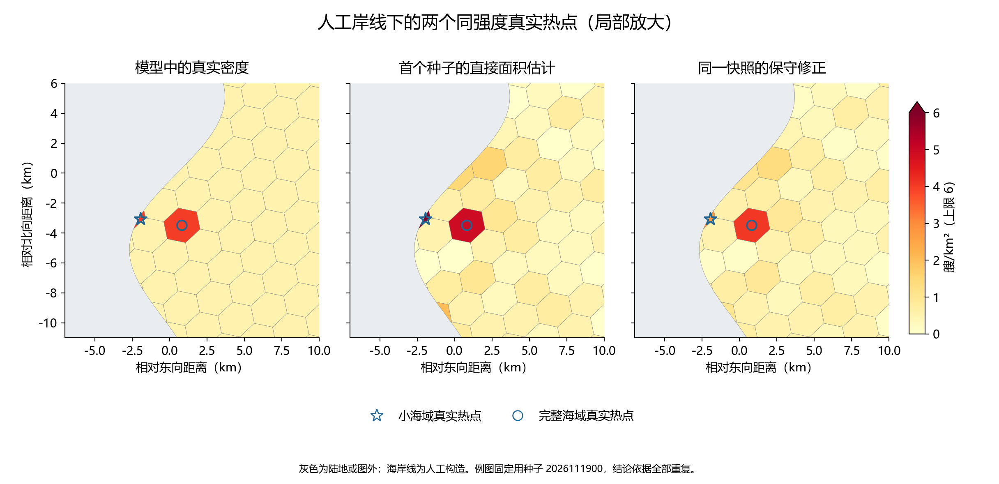
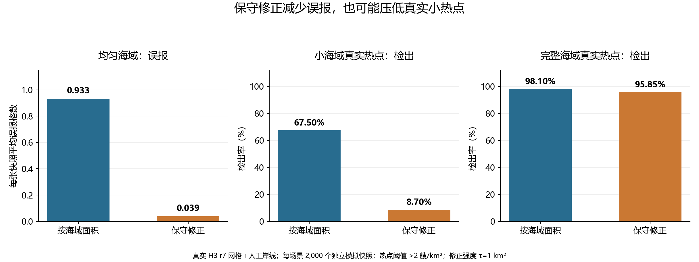
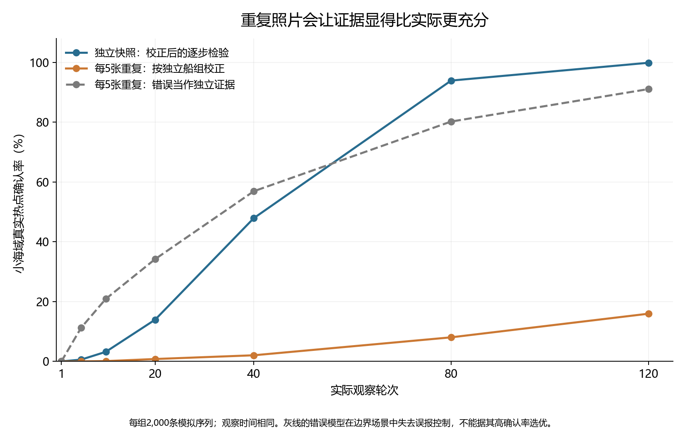

# 近岸 H3 小海域热点识别中的证据与代价

## 海洋数据挖掘技术课程研究报告

**作者：朱宸浩　学号：22634107　日期：2026年11月19日**

**公开 GitHub 仓库：[https://github.com/hanbao-chen/-](https://github.com/hanbao-chen/-)**

**完整研究对话 Markdown：[点击查看逐条原始对话](https://github.com/hanbao-chen/-/blob/main/conversations/full_conversation.md)**

工程、原始模拟计数、运行前方案和验证结果与报告同仓库保存。对话按实际记录导出，包含选题、理解困难、追问、反驳、实验执行和结论修订，导出截止时刻见对话元数据。

## 摘要

近岸H3网格按有效海域面积归一后，少量船位可形成很高的观测密度。本文以“这种高值何时足以支持持续热点”为具体问题，构造真实H3 r7网格、人工岸线和已知真值的泊松船位快照，开展配对模拟。第一阶段每场景2,000次快照：固定强度收缩将均匀海域每图平均误报格数由0.933降至0.039，却将指定小热点检出率由67.50%降至8.70%。公式推导和704,000次格子判定核查表明，该收缩用于热点判定时等价于面积相关门槛，而不是独立于门槛的识别增益。

第二阶段以精确泊松检验为成熟基线，在相同数据、截止时间和全图错误预算下，比较累计密度、收缩、固定窗口和逐步检验。独立观测下，逐步检验的小热点截止确认率为99.85%，截尾平均等待60.14轮；每5帧重复时，正确按独立组处理后的确认率仅15.95%。忽略重复结构虽提高确认率，却在边界压力场景中使全部模拟序列出现至少一处错误热点确认。三状态标签本身未改变同一证据规则的确认结果，且门槛附近大量区域长期未决。

本研究的探索贡献是机制拆解、匹配数据的对照设计和误报—未检出—等待—负担的联合评价，不宣称新算法。人工岸线、已知背景和真实重复分组均为模拟条件；真实AIS中的相关结构识别及实际管理净收益尚未验证。

**关键词：**H3；有效海域面积；泊松检验；重复观测；持续热点；待观察；全图误报

<!-- PAGE -->

## 1 课程切入点与研究命题

课程《北方的船去哪了》第6、10页强调实际面积归一，指出H3并非严格等面积；《渔场真的东移了吗》第7、10页要求按有效海域面积统计、明确计数口径并复核结论[1]。因此，单纯“除以海域面积”已经是课堂内容，不能列作本文创新。本文延伸的问题是：有效海域很小且观测稀疏时，正确的面积归一结果，是否足以支持持续热点判断？

命题分为三个可核查部分：面积收缩是否只是改变门槛；有效独立观测与重复照片的证据是否相同；在严格误报约束下，确认热点需要付出多少等待与未决代价。单次高观测密度与持续高强度分别讨论，当前时刻有船并不等于长期繁忙。

## 2 空间模型与统计对象

网格以30.5°N、122°E附近的H3 r7格为中心，取10圈，共331格。坐标仅用于放置网格；岸线为人工波浪边界，不代表该处真实海岸。用球面Lambert方位等积投影计算网格与海域交集，保留176个正海域面积格，总海域面积654.050 km²。完整格投影面积与H3球面面积的最大相对差约1.95e-11。H3面积差异及接口依据官方文档[2-3]。

| 参数 | 设置 |
|---|---|
| 背景期望密度 | 0.5艘/km² |
| 真实热点期望密度 | 4艘/km² |
| 热点业务定义 | 真密度严格大于2艘/km²，教学设定 |
| 指定小热点海域面积 | 0.275460 km²，占完整格6.813% |
| 同强度完整海域热点面积 | 4.045998 km² |



图1　人工岸线下的局部网格。例图固定使用首个种子2026111900，未按图形效果挑选。两个热点先依据几何选定，不读取模拟船数。

<!-- PAGE -->

## 3 面积收缩的效果与副作用

第一阶段设均匀场景和热点场景，各独立重复2,000次。给定第i格有效海域面积A_i和期望密度λ_i，生成N_i～Poisson(λ_i A_i)。直接生成格内计数，等价于格内强度恒定的空间泊松过程落格。每个模拟可见船在一个快照中只计一次；本实验不使用真实AIS轨迹，不把报文数当船数，也不解释为周到访船数。

直接面积法为D_i=N_i/A_i。收缩候选为S_i=(N_i+τm)/(A_i+τ)，主设置τ=1 km²。每个重复独立生成20个历史快照的合并计数，用其区域总数估计m；不读取当前快照或真值。两种方法复用相同当前数据，均以估计密度>2判热点。

| 指标 | 直接海域面积法 | 收缩 τ=1 |
|---|---:|---:|
| 均匀场景每图平均误报格数 | 0.933 | 0.039 |
| 小海域真实热点检出率 | 67.50% | 8.70% |
| 完整海域真实热点检出率 | 98.10% | 95.85% |
| 小海域真实热点漏检率 | 32.50% | 91.30% |



图2　固定收缩减少误报，同时压低真实小热点。各组为2,000次结果，下降的误报不能单独证明整体识别更优。

按独立重复进行5,000次配对Bootstrap，直接面积法减收缩的均匀场景误报差为0.894格/图，95%区间[0.855,0.9325]；小热点检出率差为58.80个百分点，区间[56.60,60.90]。区间只反映本模型的重复波动。

在泊松模型内，E[D_i]=λ_i，Var[D_i]=λ_i/A_i。因此，直接面积法并非算术错误，而是小面积下方差较大。小样本率平滑及收缩均有成熟基础[4-5]。

<!-- PAGE -->

## 4 失效机制与门槛对照

S_i可写为[A_i/(A_i+τ)]D_i+[τ/(A_i+τ)]m。指定小格只给本格观测约21.6%权重，给区域平均约78.4%权重。热点场景历史区域均值的期望约0.523；即使本格真密度为4，收缩估计的期望也仅约1.274，低于门槛2。区域平均不能充分代表真实局部高值。

| 小格当前船数 | 原始面积归一密度 | 收缩密度，m取其期望 |
|---|---:|---:|
| 1 | 3.63 | 1.19 |
| 2 | 7.26 | 1.98 |
| 3 | 10.89 | 2.76 |

真热点每张快照期望仅1.102艘，常出现0、1或2艘。2,000次中恰好1或2艘共有1,176次，它们被直接面积法检出，却被主收缩压低。泊松尾概率复核的小热点检出概率约66.77%和10.00%，与模拟的67.50%和8.70%相容。

进一步推导：S_i>2，当且仅当D_i>2+τ(2-m)/A_i。主收缩对指定小格的等价门槛约7.36，对完整格约2.37。按每次实际m逐条核查，两场景共704,000次格子判定完全一致。这是分类规则等价，不是新定理首创。

| 方法 | 均匀场景误报格/图 | 小热点检出率 | 完整格热点检出率 |
|---|---:|---:|---:|
| 原始密度门槛2 | 0.933 | 67.50% | 98.10% |
| 原始密度门槛4 | 0.236 | 30.15% | 44.90% |
| 原始密度门槛8 | 0.092 | 8.70% | 0% |
| 主收缩后门槛2 | 0.039 | 8.70% | 95.85% |

统一门槛约17.59按已知均匀背景理论校准到相近误报水平后，实际误报0.0315格/图，小热点检出1.10%，完整格0%。这是追加诊断，不是原先预设主比较。预设τ=0.25时，小热点检出仍67.50%、误报降至0.493；它只提供待验证候选，不能凭同一测试数据宣布最优。该平台与整数船数门槛未改变有关。

<!-- PAGE -->

## 5 成熟基线与连续观测的公平设计

选用单侧精确泊松检验作为证据基线。该方法及暴露量用法已有官方实现[6]。累计计数为K，有效独立观测次数为n，暴露量E=A_i n。在业务边界λ=2下，热点方向p值为P{Poisson(2E)≥K}，低密度方向为P{Poisson(2E)≤K}。这检验是否有证据超过2，而不只是是否高于背景0.5。后者会改变问题。

第二阶段沿用176格，设置均匀、两个真实热点、全格恰好密度2的边界压力场景。每场景分别采用独立快照与每5帧重复，共6个条件，每条件2,000条独立模拟序列，每条120轮。只在第1、5、10、20、40、80、120轮检查。所有方法在同一条件内使用相同数据，背景0.5为共同已知参数，不调用第一阶段历史数据。

| 方法 | 判定与数据使用 |
|---|---|
| 累计密度二分类 | K/(轮次×面积)>2，每次检查可更新 |
| 累计收缩二分类 | (K+0.5)/(轮次×面积+1)>2，等效先验只加一次 |
| 固定窗口精确检验 | 第120轮才作证据判断 |
| 逐步精确检验 | 七个预定时点检查，首次证据充分后固定方向 |

检验输出为确认热点、待观察、证据支持非热点。对格数、判断方向和检查次数使用Bonferroni：固定窗口每方向阈值0.05/(2×176)，逐步检验为0.05/(2×176×7)。在单次模型成立时，全图任一方向出现错误证据的概率上界不超过0.05[7]。这是透明但保守的基线，不是最优序贯方法；成熟置信序列等可进一步研究[8]。

候选规则与指标在运行前写入方案，但没有外部预注册。按独立序列统计，不能把同一序列内所有格子当作独立重复。时间单位为模拟轮次，未标定真实采样间隔、数据延迟或独立性尺度。

<!-- PAGE -->

## 6 增加有效观测后的确认率与等待

| 独立观测轮数 | 小热点确认 | 小热点待观察 | 判为非热点 |
|---|---:|---:|---:|
| 10 | 3.20% | 96.80% | 0% |
| 40 | 47.90% | 52.10% | 0% |
| 80 | 93.90% | 6.10% | 0% |
| 120 | 99.85% | 0.15% | 0% |

独立数据下，逐步检验截止确认1,997/2,000个小热点。截尾平均等待60.14轮：未确认的3例按120轮计入，而非剔除。固定窗口在120轮确认2,000/2,000例，等待120轮。逐步减固定的截尾等待差为-59.86轮，配对95%区间[-61.09,-58.61]；截止确认率差为-0.15个百分点，区间[-0.35,0]。这是提前发布与保守校正之间的取舍。



图3　相同实际轮次未必包含相同有效信息。灰线忽略相关性，不具有宣称的误报控制，不能按其较高确认率选优。

累计密度法在独立均匀场景的截止误报仅0.002格/图，但75.15%的序列曾在某次检查误报。最终图正确，不能抹去先前警报。确认等待需与整个监测期的误报共同评价。

60.14轮从监测开始计算，不是已验证的新增热点预警时延。若轮间隔、独立性或检查排程改变，必须重新评价；不能直接称60.14分钟。

<!-- PAGE -->

## 7 重复观测与统计对象

重复模型令每5帧共享同一组船位，组间独立更新，120帧只有24个独立组。所有方法获得相同数据和真实组标签；错误方法故意忽略分组，校正方法每组只取首帧作为独立信息单元。同一船持续在场可以贡献占用时长，不能自动贡献等量独立证据。组内身份可由生成器定义，不代表真实MMSI。

| 重复场景下的逐步检验 | 小热点确认 | 待观察 | 判为非热点 |
|---|---:|---:|---:|
| 错当120份独立证据 | 91.05% | 7.75% | 1.20% |
| 按24个独立组校正 | 15.95% | 84.05% | 0% |

高确认率并不意味着更可靠。在全格真密度恰为2的边界场景中，这些格子均不符合“严格大于2”的热点定义：

| 逐步检验模型 | 序列中曾至少误确认一格的比例 | 截止平均误确认格数 |
|---|---:|---:|
| 独立数据，模型正确 | 1.35% | 0.0135 |
| 5帧重复，错误当作独立 | 100% | 19.586 |
| 5帧重复，真实分组校正 | 1.55% | 0.0155 |

“100%”的分母是2,000条序列。一条序列包含176格、120轮，任一次检查误确认任一格即计1；错一格或多格不重复计入此指标。它不表示每格都错。错误方法截止平均误确认约19.6/176格，约11.1%。

同一重复热点数据下，固定窗口分组校正的截止确认率为32.15%，逐步校正仅15.95%，相差-16.20个百分点，配对95%区间[-17.85,-14.60]。这说明简单多次校正确有额外代价；并非校正后结果天然最优。

真实分组由生成器直接提供，没有从照片或AIS估计。此结果是已知相关结构的参照，不是现实自动识别能力或已经证明的性能上限。

<!-- PAGE -->

## 8 待观察的代价与公平评价

允许暂不分类的思想已有选择性分类基础[9]。本文保留原始密度，另发布证据状态。逐点核查表明，由同一高方向证据生成二分类或三分类，确认热点结果完全相同。因此，三状态标签本身没有提高即时确认率。

真实热点的三种结果必须守恒：确认热点＋待观察＋判为非热点=100%。截止未检出=待观察＋判为非热点。重复模型中正确逐步检验的84.05%待观察，应如实计入截止未检出，不能因“未错误否定”而称全部成功。

| 条件，均为第120轮逐步检验 | 平均待观察格数 | 其中观测密度>2的候选格数 |
|---|---:|---:|
| 独立观测，背景加两个热点 | 2.2355 | 0.0035 |
| 重复观测，分组校正，背景加热点 | 5.3150 | 0.9485 |
| 独立观测，所有格恰好在门槛 | 175.9655 | 87.5330 |

边界场景为刻意压力测试，不是实际海域分布。但它说明，真实密度接近门槛时，长期未决可能占满地图。候选普通区域即使不算“误确认”，仍可能消耗核查资源。

独立热点场景中，固定窗口的累计高值候选待观察量为248.19格·轮，逐步检验为73.56格·轮。这是预设队列规则下的负担代理，不是实测人工工时或算力节约。全部观测已向各方法提供，本文没有部署节省采样的策略，也未给出误报、漏报和等待的业务成本权重，不能宣称实际净收益更高。

严格阈值也有业务含义。若将1.8～2.2设为容许区间，研究会从“严格区分2两侧”改为区分明确低值和高值；该区间不能等同于统计置信区间。本文只在对话中讨论了这种目标变化，所有已运行实验仍采用严格>2，未将边界难例排除后重算成绩。

<!-- PAGE -->

## 9 原创探索贡献的具体拆解

### 9.1 从改进候选追问到等价门槛

起点是AI提出的海域面积校正后收缩。学生要求先比较误报与真实热点漏检，随后追问“提高判定门槛能否达到类似效果”。本研究给出公式等价、统一门槛对照和逐条判定核查，将“误报下降”拆成可解释的规则变化。贡献是对具体候选的机制检验及失败边界，不是把成熟收缩重新命名为新算法。

证据对应：第一阶段summary.json、trials.csv、两份计数矩阵，以及threshold_diagnostic/diagnostic.json。当前小格的低权重与均值偏移解释了强收缩漏检；统一门槛又显示面积相关性能够保留完整格灵敏度，但不能消除小格代价。

### 9.2 用相同数据揭露虚假确信

学生进一步追问同船停留是否构成多份独立证据。本文将空间面积、真密度和计数数据固定，只改变是否正确使用重复结构，并增加门槛边界压力场景。高检出率与失控误报同时出现，使“更多确认是否意味着更好”成为可证伪问题。

证据对应：重复场景block_counts、保存的状态与首次确认轮次、boundary逐重复数据。该工作量化了本模拟中的重复计数后果，但相关性引发虚假确信本身并非本文首次发现，真实结构估计也尚未完成。

### 9.3 将未决与等待纳入完整分母

学生提出保留原始密度、证据不足标待观察，并连续追问统计对象、严格校正、实际时间和核查负担。本文据此同时记录确认、待观察、非热点、截止未检出、截尾等待和候选格·轮，避免只在成功案例或已分类案例中评价。

证据对应：第二阶段210行条件摘要及逐序列状态。结论是标签的即时确认增益为零，后续有效信息与证据规则才可能产生收益；边界未决积压是明确代价。评价框架与拒判思想已有基础，本文贡献是海洋近岸情境下的具体组合、执行和机制解释。

上述三项构成课程层面的原创实验探索。本文不声称方法首创、普遍最优、实际港口性能提升或真实管理净收益。研究者的实际追问及修正见首页完整对话链接，不能用本节摘要替代原始记录。

<!-- PAGE -->

## 10 结论边界与对命题的回答

本研究在给定模型内支持：小海域的高观测密度可以算术正确，但不自动证明持续繁忙；固定强度收缩在降低误报的同时，可能通过隐性提高门槛压低真实小热点；把相关快照当成独立样本会夸大证据；严格全图误报控制下，等待与截止未确认需要共同报告。

研究结论有以下限制。

1. 岸线和船位均为模拟。海域放置坐标不是实测海岸，未使用真实AIS、接收覆盖、航道或定位误差。
2. 模型在观察期间保持密度不变；未测试短时船队、热点出现或消失、潮汐驱动变化。等待从监测开始计，不是已验证的新增热点发现时延。
3. 背景密度0.5在第二阶段共同已知；真实背景估计误差未进入检验。初期局部历史被压成全域均值的收缩，也不代表充分利用历史数据的最佳方法。
4. 重复场景的真实块边界已知，块内完全重复、块间完全独立。真实船位往往异步停留、混合相关；同一船身份也不等同于独立性判断。
5. 分组过短可能继续夸大证据，过长可能丢掉信息。本文没有估计分组，也没有将估计误差传播到检验，因此不能保证实际系统维持同样的5%上界。
6. Bonferroni预算平均分配，清晰但保守；本文未与所有更高效序贯方法比较，当前低确认率不是已证明的信息极限。
7. 真实密度2的全图场景用于压力测试。不能把该场景100%的序列误报比例解释为真实系统每格必然出错。
8. 没有人工用户实验、真实观测间隔或业务成本权重。候选格·轮与截尾等待不能直接转换为工时、分钟或净收益。

对核心命题的回答是：需要把“观测密度高”和“持续热点证据充分”分开。分开的价值在于准确表达和组织后续行动；只有在同样数据、风险承诺和截止时间下，能减少错误处置或更及时确认，才可进一步声称实际改进。本项目完成了这一命题的受控检验，尚未完成真实数据上的部署验证。

<!-- PAGE -->

## 11 工程复现与人机协作记录

实验环境为Windows、Python 3.11.4、NumPy 1.24.3、SciPy 1.10.1、Matplotlib 3.7.1、H3 Python 4.3.1/核心4.3.0、Shapely 2.1.2。H3版本关系依据官方发布说明[10]。运行日期为2026年11月19日。固定种子、输入计数和指纹与工程一并保存。

在项目根目录执行下列命令。verify仅依赖标准库，规范Windows路径分隔符后核对47项原始文件指纹和210行连续结果的状态守恒。完整复现使用新目录，不覆盖随包原始结果。

```text
python run_project.py verify
python -m venv .venv
.venv\Scripts\python -m pip install -r requirements.txt
.venv\Scripts\python run_project.py reproduce --output reproductions/my_run
```

完整复现包括两阶段模拟、追加门槛诊断、直接p值重放核查和数值摘要比较。本次交付前已在隔离新目录实际运行，三个数值摘要比较均一致，记录见verification/reproduction_check.json。原始指纹、复现结果与完整对话分别承担数据完整性、工程可复现性和研究过程留痕作用，不互相替代。Poisson临界计数与直接尾概率核查一致；第二阶段还对6个场景中每个方法的11条固定序列，用另一种逐帧重建方式核对状态和首次确认轮次。

| 参与方 | 实际承担的工作 |
|---|---|
| 朱宸浩 | 提供课程与参考材料；要求解释后确认选题；提出门槛对照、成熟基线、连续观测、统计对象、等待、容许区间、待观察价值及真实分组限制等追问；形成自己的理解；授权整理与发布 |
| AI助手 | 读取课程资料，检索方法来源；提出候选、推导与对照设计；编写并通过工具执行模拟、核查、绘图和工程复现；依据输出起草报告 |

学生曾明确表示“其实没有理解，讲一下你的判断吧”，解释后才确认题目。完整记录保留这一过程，不将最早的选项或AI建议写成学生已经独立提出的算法。本报告也不表述学生已经独立编写全部代码或完成独立复现。

逐条对话由应用实际持久化记录导出，保留用户文字、AI对外回复及结构化问题和答复；不导出系统指令或内部推理。末尾发布交付通知发生在导出之后时，以导出元数据截止时刻为准。材料准备与上传状态另见工程发布记录，不改变上述研究结果。

<!-- PAGE -->

## 参考资料

[1] 课程提供课件：《第3讲_课时1_北方的船去哪了_修订版》，第6、10页；《第3讲_课时2_渔场真的东移了吗_修订版》，第5、7、10页。依据原件核对，不随公开仓库分发课件原文。

[2] H3. Tables of Cell Statistics Across Resolutions. [官方文档](https://h3geo.org/docs/core-library/restable/)。说明同分辨率格子非严格等面积。

[3] H3. Miscellaneous H3 functions. [官方面积接口](https://h3geo.org/docs/api/misc/)。

[4] Esri. How Calculate Rates works. [官方方法说明](https://pro.arcgis.com/en/pro-app/3.5/tool-reference/spatial-statistics/how-rates-works.htm)。小数目不稳定性和已有率平滑方法。

[5] Gelman A, Price PN. All maps of parameter estimates are misleading. Statistics in Medicine, 1999, 18:3221–3234. [作者提供全文](https://sites.stat.columbia.edu/gelman/research/published/allmaps.pdf)。讨论原始率与收缩地图可能出现的样本量相关伪象。

[6] R stats. Exact Poisson tests. [官方文档](https://stat.ethz.ch/R-manual/R-devel/library/stats/html/poisson.test.html)。实验用SciPy尾概率实现相同的一侧检验逻辑，未声称实际调用R运行。

[7] R stats. Adjust P-values for Multiple Comparisons. [官方文档](https://stat.ethz.ch/R-manual/R-devel/library/stats/html/p.adjust.html)。区分全族错误率与错误发现率，说明Bonferroni等方法。

[8] Howard SR, Ramdas A, McAuliffe J, Sekhon J. Time-uniform, nonparametric, nonasymptotic confidence sequences. The Annals of Statistics, 2021, 49(2):1055–1080. [论文](https://arxiv.org/abs/1810.08240)。本文只据其讨论后续方法，没有将其实现为已运行算法。

[9] El-Yaniv R, Wiener Y. On the Foundations of Noise-free Selective Classification. JMLR, 2010, 11:1605–1641. [论文](https://jmlr.org/papers/v11/el-yaniv10a.html)。用于说明允许拒判与风险—覆盖权衡的已有基础，不将其噪声自由假设移植为本实验保证。

[10] H3 Python 4.3.1. [发布记录](https://pypi.org/project/h3/4.3.1/)。

外部资料访问日期：2026年11月19日。正文数值来源为本项目实际工程输出，引用资料只构成方法背景。同学参考报告仅用于理解提交深度，本文未沿用其重试模型、参数和结果。

**完整证据入口：[公开仓库](https://github.com/hanbao-chen/-)；[完整人机对话](https://github.com/hanbao-chen/-/blob/main/conversations/full_conversation.md)。**
